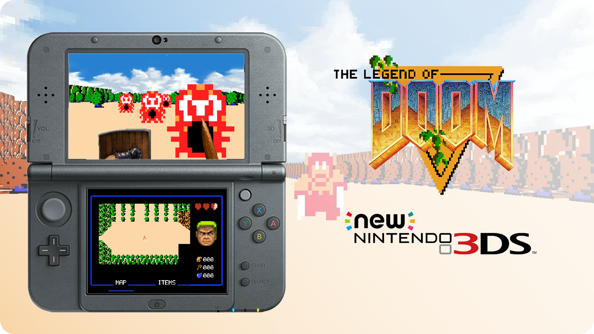

<h1 align="center">Legend of Doom 3DS</h1>

<p align="center">
  <strong>Explore Hyrule from a new perspective.</strong><br>
  The Legend of Zelda meets first-person adventure on New Nintendo 3DS.
</p>

<p align="center">
  <a href="#download-and-installation">Download</a> ·
  <a href="#features">Features</a> ·
  <a href="#documentation">Documentation</a> ·
  <a href="#community-and-bug-reports">Community</a>
</p>

<p align="center">
  <a href="https://github.com/EstebanPdN/legend-of-doom-3ds/releases/tag/v1.0"></a>
  <a href="#download-and-installation"></a>
  <a href="platform/3ds/UPDATER.md"></a>
  <a href="THIRD-PARTY-LICENSES.md"></a>
</p>

<p align="center">
  
</p>

<p align="center">
  <a href="https://estebanpdn.github.io/"></a>
  <a href="https://discord.gg/BjbzfRYpV"></a>
</p>

Nintendo 3DS port of [Legend of Doom](https://github.com/emawind84/legend-of-doom), the first-person GZDoom conversion of the original *The Legend of Zelda* created by DeTwelve Games.

This project was developed with the help of [OpenAI Codex](https://openai.com/codex/). Learn more about the development process [here](AI_DEVELOPMENT.md).

**[v1.0 is available now](https://github.com/EstebanPdN/legend-of-doom-3ds/releases/tag/v1.0)** for **New Nintendo 3DS, New Nintendo 3DS XL and New Nintendo 2DS XL**. Old Nintendo 3DS, Old Nintendo 3DS XL and Nintendo 2DS are not supported.

The port uses GZDoom 4.7.1 and Freedoom: Phase 2. No NES ROM or commercial Doom IWAD is required.

## Download and installation

<p>
  <a href="https://github.com/EstebanPdN/legend-of-doom-3ds/releases/download/v1.0/legend-of-doom-3ds-v1.0.cia"></a>
  <a href="https://github.com/EstebanPdN/legend-of-doom-3ds/releases/download/v1.0/legend-of-doom-3ds-v1.0.zip"></a>
</p>

**Stable: [v1.0](https://github.com/EstebanPdN/legend-of-doom-3ds/releases/tag/v1.0).**

Download the published packages from [GitHub Releases](https://github.com/EstebanPdN/legend-of-doom-3ds/releases/latest).

| v1.0 download | Use |
|---|---|
| [CIA](https://github.com/EstebanPdN/legend-of-doom-3ds/releases/download/v1.0/legend-of-doom-3ds-v1.0.cia) | Install with FBI. Includes the matching game and engine data. |
| [Homebrew Launcher ZIP](https://github.com/EstebanPdN/legend-of-doom-3ds/releases/download/v1.0/legend-of-doom-3ds-v1.0.zip) | Includes the 3DSX and the SD data folder. |
| [Build manifest](https://github.com/EstebanPdN/legend-of-doom-3ds/releases/download/v1.0/BUILD-MANIFEST.txt) / [SHA-256 checksums](https://github.com/EstebanPdN/legend-of-doom-3ds/releases/download/v1.0/SHA256SUMS.txt) | Build identity, component revisions and file verification. |

### CIA / FBI

Install the CIA with FBI, or open **Remote Install → Scan QR Code** and scan:


The CIA contains its game data. Configuration, saves and diagnostic files are stored separately under `sdmc:/3ds/legend-of-doom/`.

### Homebrew Launcher / 3DSX

1. Extract the v1.0 ZIP.
2. Copy its included `3ds` folder to the root of the SD card.
3. Launch `sdmc:/3ds/legend-of-doom/legend-of-doom-3ds.3dsx` from the Homebrew Launcher.

Keep the included `data` folder with the executable; the standalone 3DSX download does not include those resources.

```text
sdmc:/3ds/legend-of-doom/
├── legend-of-doom-3ds.3dsx
├── README.txt
├── CREDITS.md
├── THIRD-PARTY-LICENSES.md
├── licenses/
└── data/
    ├── LegendOfDoom.pk3
    ├── freedoom2.wad
    ├── game_support.pk3
    └── gzdoom.pk3
```

### Audio setup

Audio on a real console requires its own DSP firmware at `sdmc:/3ds/dspfirm.cdc`. With Luma3DS, open the Rosalina menu, choose **Miscellaneous options...**, then **Dump DSP firmware**. This system file is not distributed with the port.

## Features

<table>
  <tr>
    <td width="50%" valign="top"><strong>A different view of Hyrule</strong><br>The first-person Legend of Doom conversion, powered by GZDoom and Freedoom: Phase 2.</td>
    <td width="50%" valign="top"><strong>Made for two screens</strong><br>Touch menus, bottom-screen map and item selection, with Circle Pad and C-Stick controls.</td>
  </tr>
  <tr>
    <td width="50%" valign="top"><strong>Choose your setup</strong><br>Install the CIA with its data, or use the complete Homebrew Launcher ZIP.</td>
    <td width="50%" valign="top"><strong>Keep it current</strong><br>Built-in CIA updates, save previews, native keyboard and quick diagnostic captures.</td>
  </tr>
</table>

### Feature details

- Dual-screen menus, touch controls, a bottom-screen map and item selection.
- Circle Pad movement and configurable C-Stick / touch camera input.
- Save/load menus with previews and the native Nintendo 3DS keyboard.
- Music and sound effects through OpenAL Soft/NDSP.
- Adjustable gameplay render scale from 50% to 100%; menus use native 400×240.
- A built-in CIA updater with stable and experimental channels.
- Quick diagnostic capture for bug reports.

The published v1.0 uses the `hardware-hybrid` profile: SoftPoly renders the world on CPU0 and CPU2, and PICA200 scales the completed image to the 400×240 top screen. Gameplay defaults to 320×192. NovaGL world rendering remains a separate developer experiment. Rendering is uncapped; actual frame rate depends on the scene and render scale.

## Controls

| Nintendo 3DS input | Action |
|---|---|
| Circle Pad | Move / strafe |
| C-Stick | Look |
| Touch screen | Look when camera input is Touch or Both; select menu rows and items |
| A | Use / interact; confirm in menus |
| B | Back / cancel in menus |
| X | Sprint at full health (optional) |
| Y | Jump |
| L / R | Alternate attack / attack |
| ZL / ZR | Previous / next inventory item |
| D-Pad left / right | Previous / next weapon |
| D-Pad down | Use inventory item |
| D-Pad up | Automap |
| START / SELECT | Open the menu |

Controller options include C-Stick sensitivity, C-Stick/Touch/Both camera input, the full-health X sprint toggle and a control reference.

## Updating

On the CIA build, open **Update** from the title or pause menu. Choose **Stable** for public stable releases. Save your progress before installing an update, because installation closes the game. Saves and configuration remain on the SD card.

For 3DSX, download the complete matching ZIP and replace the executable and data together. The in-game updater installs CIA packages only. See the [updater guide](platform/3ds/UPDATER.md) for channel behavior and troubleshooting.

## Bug reports and community

[Open a bug report](https://github.com/EstebanPdN/legend-of-doom-3ds/issues/new?template=bug_report.yml) with your version, console model, installation type and steps to reproduce the problem.

While the issue is visible, press **L + R + A** and attach the complete quick diagnostic folder from:

```text
sdmc:/3ds/legend-of-doom/dumps/
```

For updater errors, also attach `sdmc:/3ds/legend-of-doom/update.log`.

Join [Esteban's Forge on Discord](https://discord.gg/BjbzfRYpV) for updates, support and other Nintendo 3DS homebrew projects.

## Documentation

- [Repository map and maintenance conventions](docs/REPOSITORY.md)


| Guide | Purpose |
| --- | --- |
| [3DS build guide](platform/3ds/README.md) | Profiles, dependencies, package layout and checks. |
| [Built-in updater](platform/3ds/UPDATER.md) | CIA channels, installation and troubleshooting. |
| [Maintenance roadmap](docs/ROADMAP.md) | Project documentation and development history. |
| [Credits](docs/CREDITS.md) | Original game conversion and platform contributors. |
| [Third-party licenses](THIRD-PARTY-LICENSES.md) | Component and game-data notices. |

## Building from source

Install devkitPro/devkitARM, libctru, 3ds-cmake, CMake, Python 3, Git, cURL and UnZip, plus a native C/C++ compiler and SDL2 development files for the host tools. CIA packaging also uses `makerom` and `bannertool`.

Build the same renderer profile used by the published v1.0:

```sh
./platform/3ds/build.sh hardware-hybrid
```

Calling the script without a profile builds the `hardware-safe` CPU-only recovery profile. GitHub Actions also builds that recovery profile; its artifacts are separate from the published v1.0 download. Output packages are written to `build-3ds/dist/` by default.

See the [3DS build guide](platform/3ds/README.md) for all profiles, dependencies, package names and checks, and the [maintenance roadmap](docs/ROADMAP.md) for the documentation history.

## Credits

- [DeTwelve Games](https://youtube.com/DeTwelveGames) — creator of Legend of Doom
- [GZDoom contributors](https://github.com/ZDoom/gzdoom) — engine
- [Freedoom contributors](https://github.com/freedoom/freedoom) — Phase 2 IWAD
- [NovaGL contributors](https://github.com/efimandreev0/NovaGL) — experimental OpenGL-to-Citro3D bridge
- SDL, ZMusic, OpenAL Soft/NDSP, Citro2D/Citro3D, devkitPro and libctru contributors — platform stack
- Esteban PDN — Nintendo 3DS port and project maintenance

See [CREDITS.md](docs/CREDITS.md) and [THIRD-PARTY-LICENSES.md](THIRD-PARTY-LICENSES.md) for additional notices.

## License and game content

The GZDoom-derived source is distributed under **GNU GPL v3.0**. See [LICENSE](LICENSE) for the complete terms. Third-party code and data retain their component-specific terms and notices in [THIRD-PARTY-LICENSES.md](THIRD-PARTY-LICENSES.md). The engine license does not relicense the game data.

Each release tag provides its corresponding source through GitHub's source archives.

Legend of Doom's upstream repository does not declare a general open-source license. Its data is downloaded during the build and is not committed here; the original credits and component notices are preserved in the packages.

*The Legend of Zelda* and related names and content are owned by Nintendo. *Doom* and related names are owned by id Software and their respective rights holders. This unofficial fan project is not affiliated with or endorsed by Nintendo, id Software or Bethesda.

## Community and bug reports

[Join the project Discord](https://discord.gg/BjbzfRYpV) for updates, testing,
suggestions and support. Use [GitHub issues](https://github.com/EstebanPdN/legend-of-doom-3ds/issues)
for reproducible reports, including your version, console model and steps to
reproduce the problem. Review diagnostic captures before sharing them.

---

<p align="center">
  <a href="https://estebanpdn.github.io/">Esteban’s Forge</a> ·
  <a href="https://discord.gg/BjbzfRYpV">Discord</a> ·
  <a href="#documentation">Documentation</a> ·
  <a href="THIRD-PARTY-LICENSES.md">License and notices</a><br>
  <sub>An independent fan project. Game names and content belong to their respective owners.</sub>
</p>
